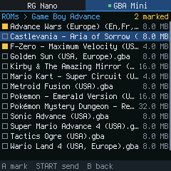
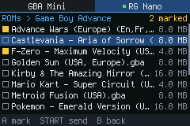
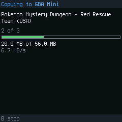

# Handheld Link

Browse another handheld over a USB cable and send it ROMs, saves, save
states, game art, apps and settings. Either handheld can browse the other
and send or fetch; there is no PC, Wi-Fi or approval step involved.

Handheld Link runs on **FunKey OS** (DrUm78's builds). It was tested
between an **Anbernic RG Nano** (240x240) and a **GBA Mini**, a 240x160
FunKey S clone. The screens scale with the display, so other handhelds can
follow.





## What you need

- Two FunKey OS handhelds with the **same version** of Handheld Link.
- One of them must be able to be the **USB host**: the RG Nano can. The GBA
  Mini can only be the USB device (its operating system sets the port up
  that way), so it always goes on the other end.
- An **OTG adapter** for the host (USB-C male to USB-A female), and the USB
  cable the other handheld uses with a PC. A charge-only cable won't work.
- The other handheld's USB mode on **ADB** (FunKey OS's default; switch it
  with USB Mode in Applications if you changed it).

## Install

Download `HandheldLink-<version>.opk` from the
[latest release](https://github.com/DankMiimer/handheld-usb-link/releases/latest)
and copy it to the **Applications** folder on each handheld's card (as
`HandheldLink.opk`). Restart the menu or the handheld, and **Handheld Link**
shows up in Applications.

## Use

1. Put the OTG adapter in the host (the RG Nano) and connect the cable from
   it to the other handheld.
2. Open **Applications > Handheld Link** on both, in either order. Each one
   opens on the other handheld's tab, which says what it is waiting for.
   When they link (a few seconds), that tab shows the other handheld's name
   with a green dot.
3. Pick what to share (ROMs, Saves, ...), then a system or folder, and mark
   items with **A**. **Start** opens a menu: send the marked items (or the
   highlighted one) to the other handheld, mark all, or unmark all. On the
   other handheld's tab the same menu copies them here instead.
4. If something is already there, it asks each time: **Replace**, **Skip**,
   **Replace all**, **Skip all** or **Stop**. It shows the size and date on
   both sides.

| Button | |
|---|---|
| L / R | this handheld / the other one, at the same place in the lists |
| D-pad up / down | move; left / right: a page at a time |
| A | open; in a list of games or files, mark or unmark |
| Start | the send / copy menu |
| B | back; on the first screen, quit |

The handheld that receives files shows what is arriving at the bottom of its
screen. Handheld Link never deletes anything; only **Replace** overwrites
the file that was there. A file being copied when you stop or unplug is
dropped; the ones already done stay.

## What goes where

Each handheld decides where received files go on its own card, so a Game Boy
save lands in its Game Boy emulator's save folder whatever the other one
calls it.

| Category | On FunKey OS |
|---|---|
| ROMs | the system folders in the card's root (`Game Boy Advance`, `SNES`, `PS1`...), files with the extensions that system's emulator opens. A `.cue` or `.m3u` brings its tracks or discs along |
| Saves | `FunKey/.picoarch/data/<emulator>/` (`.sav`, `.srm`, `.rtc`, ...); Nintendo DS: `drastic/backup` |
| Save states | the same folders (`.st0`-`.st9`, the quick-save `.st99`, with their screenshots); DS: `drastic/savestates` |
| Game art | the picture next to each ROM (`Game.png` beside `Game.gba`) |
| Apps | the OPKs, with their icons, in Applications, Native games, Emulators, Libretro (also its cores) and Settings |
| Settings | app data folders in `FunKey/` (each sent whole), and picoarch's settings per game and per emulator |

Not offered: the menus' own folders (`.retrofe`, `.gmenu2x`, `.frontend`),
screenshots, and USB Link's settings and keys.

## Speed

Copying runs at about 1.2 MB/s from an RG Nano to a GBA Mini: about 15
seconds for a 16 MB GBA game, a quarter of an hour for 1 GB. Both handhelds
get warm during long copies, because the RG Nano's processor is busy the
whole time. The limit is the Python on the RG Nano that drives the USB side.
FunKey OS's `adbd` takes 4 KB at a time and acknowledges each piece, and
Python needs about 3 ms per piece there. Four ADB streams at once (0.3.0)
didn't change that. A faster link over USB networking is planned.

## Settings (optional)

`FunKey/hlink/hlink.conf` on the card, one `KEY=value` per line:

- `NAME=` what the other handheld calls this one (default: the model, such
  as RG Nano or GBA Mini).
- `ROLE=host` or `ROLE=device`. By default a handheld whose port can be a
  host is the host. **Two RG Nanos:** set `ROLE=device` on the one without
  the OTG adapter (this pairing is untested).

## Troubleshooting

- **"Open Handheld Link on the other handheld."** The other handheld is
  plugged in and answers, but the app isn't open there.
- **"Looking for the other handheld"** doesn't change: check that the cable
  carries data (the one that works with a PC), that the other handheld is in
  ADB mode, and that Handheld Link is open there. Reopening it there, or
  restarting it with the cable in, also helps.
- **"A PC or charger is on the USB port."** The host found power on its own
  port. Unplug the PC or charger and use the OTG adapter.
- **"The other handheld has another version."** Put the same OPK on both.
- **The GBA Mini doesn't come back on a PC after unplugging.** Its USB side
  doesn't notice cables coming and going: after an unplug it stays off until
  it is restarted. Handheld Link works around this while it is open
  (5 seconds after the cable comes out it resets the USB side, and the next
  host finds it). Outside the app, restart the GBA Mini with the cable in.
- **Logs:** `FunKey/hlink/hlink.log` on each handheld's card. The host's log
  also records its USB port and the kernel's USB messages.

## How it works

- The handheld with the OTG adapter is the USB host. It talks ADB to the
  other handheld's `adbd` directly through Linux usbfs, in Python (no adb
  binary), like USB Netplay's ADB tunnel. FunKey OS's `adbd` asks for no
  authorisation.
- Each handheld runs a small file service on `127.0.0.1:55441`. Through
  `adbd`'s `tcp:` service the host opens two connections to the other
  handheld's service: one for its own requests, and one it hands over for
  the other handheld's requests to it. So either side can browse and send.
- Each connection is four ADB streams carrying one byte stream: piece *n*
  goes on stream *n* mod 4, and the other end reads them back in order, so
  files are still written front to back (out-of-order writes are slow on
  FAT cards).
- A file is written to `<name>.hlink-part` and renamed when it is complete,
  with the sender's date. File names from the other side are checked so
  nothing is written outside the folder it belongs in.
- An OTG adapter switches the RG Nano's port to host mode by itself, and
  Handheld Link leaves the port alone. For an adapter that doesn't, press A
  on the other handheld's tab: Handheld Link switches the port (never with a
  PC or charger on it) and puts it back after 30 s with nothing found, when
  the other handheld is unplugged, or when the app quits.
- The screen is drawn straight to the framebuffer. The font (6x12, 8x16 or
  12x24) and the layout follow the size of the panel's visible area, so the
  same screens fit 240x160 up to 640x480 and beyond.

## Building

```sh
handheld-link/funkey/build_opk.sh    # -> handheld-link/funkey/HandheldLink.opk
```

FunKey OS has no Python, so the OPK brings a Python 3.12 runtime built for
it (32-bit ARM, musl, about 8 MB in the OPK). The build takes it from
`HLINK_PY_RUNTIME`, by default the one that
[rg-nano-adb-tools](https://github.com/DankMiimer/rg-nano-adb-tools)'
`wifi/build_wifi_opk.sh --build-only` leaves in
`~/.cache/rg-nano-adb-tools/wifi/runtime`. It also needs `mksquashfs` and
`python3.12`.

`python3 handheld-link/tools/preview.py OUTDIR` draws the screens into PNGs
at 240x240, 240x160 and 640x480, with no handheld. `sh tests/run.sh` runs the
tests, including the file service, the stream groups and the host's ADB code
against a stand-in `adbd`.

The font is converted from the Terminus Font (SIL Open Font License 1.1, see
[FONT-LICENSE.txt](FONT-LICENSE.txt)).
